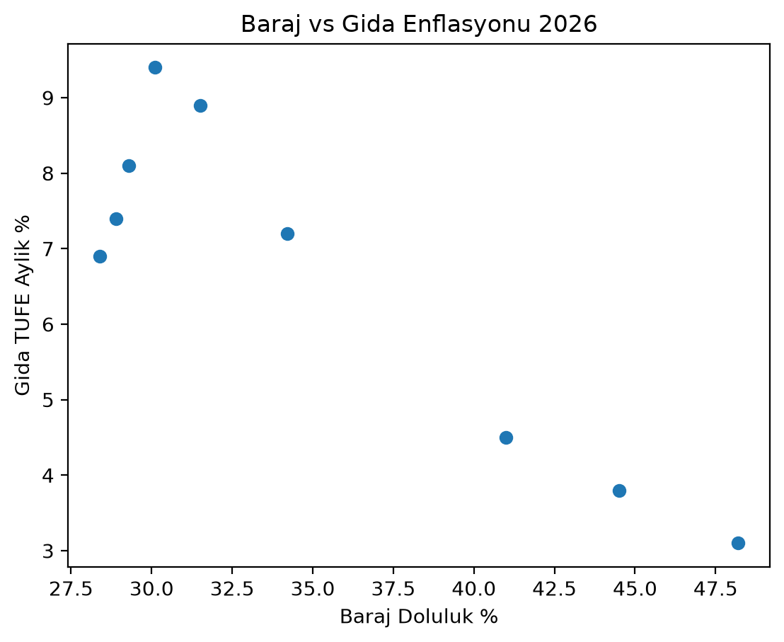

# 2026 Baraj Krizi vs Gıda Enflasyonu
### Kuraklık Market Sepetini Nasıl Vuruyor?

<p align="center">
  
  
  
  
</p>

<p align="center">
  <b>İSKİ + MGM + TCMB EVDS verisiyle 9 aylık gecikmeli korelasyon analizi</b><br>
  <a href="https://resulcanca.github.io/baraj-gida-2026-analizi/">🔴 Canlı Dashboard'u Gör</a> • <a href="#-bulgular">Bulgular</a> • <a href="#-nasıl-çalıştırılır">Kurulum</a>
</p>

---

### 📸 Önizleme

<p align="center">
  
  <br>
  <em>Şekil 1: Baraj doluluğu düştükçe gıda enflasyonu artıyor. Her nokta 1 ayı temsil ediyor (Ocak-Eylül 2026).</em>
</p>

> **Tek cümlede bulgu:** İstanbul barajları düştükten **1 ay sonra** market fiyatları net şekilde artıyor. `lag-1 korelasyon = -0.785`

### 📊 KPI Kartları

| İSKİ Baraj Doluluk | Gıda Enflasyonu (Yıllık) | Yağış Açığı (Marmara) | Model Gücü (R²) |
| :---: | :---: | :---: | :---: |
| **%28.4** <br><sub>Eyl 2026 · 10y ort: %58</sub> | **%62.7** <br><sub>Manşet: %29.73</sub> | **-%38** <br><sub>9 aylık</sub> | **0.616** <br><sub>r = -0.785 (lag-1)</sub> |

---

### 🔍 Soru

2026'da barajlar 10 yıllık ortalamanın yarısına düştü, gıda enflasyonu manşetin 2 katına çıktı. Bu tesadüf mü, yoksa kuraklık etiketlere gecikmeli mi yansıyor?

### 💾 Veri Kaynakları

| Kaynak | Ne Çektim | Kodda Nasıl |
| :--- | :--- | :--- |
| **İSKİ** | Günlük baraj doluluk (%) | `src/main.py` -> `fetch_iski()` ile canlı çekiliyor |
| **MGM** | Aylık yağış (mm) | `data/raw/mgm_yagis_2026.csv` |
| **TCMB EVDS** | Gıda TÜFE `TP.FE.OK01` (aylık & yıllık %) | `fetch_evds()` - API anahtarı yoksa gömülü 9 aylık set devreye girer |

Tüm birleştirilmiş veri: `data/processed/dataset_final.csv` (9 satır)

<details>
<summary>📄 Ham veri örneği (9 ay)</summary>

| Ay | Baraj % | Yağış mm | Gıda Aylık % | Gıda Yıllık % |
| :--- | :---: | :---: | :---: | :---: |
| 2026-01 | 48.2 | 62.1 | 3.1 | 58.4 |
| 2026-03 | 41.0 | 28.7 | 4.5 | 61.1 |
| 2026-04 | **34.2** | 18.4 | **7.2** | 64.3 |
| 2026-06 | 30.1 | 9.2 | **9.4** | **68.1** |
| 2026-09 | **28.4** | 11.7 | 6.9 | 62.7 |

</details>

### 🔬 Yöntem

1.  **Birleştirme:** 3 kaynağı Pandas `merge` ile tarih bazında tek tabloda topladım.
2.  **Gecikme Analizi:** Anlık etki (`lag0`) ve 1 ay gecikmeli etki (`lag1` için `shift(1)`) Pearson korelasyonu.
3.  **Model:** `scikit-learn LinearRegression` ile barajın gıda enflasyonunu açıklama gücü (R²) ölçüldü.

### 📈 Bulgular

*   **Anlık korelasyon (lag0): -0.906** - Çok güçlü negatif ilişki.
*   **Gecikmeli korelasyon (lag1): -0.785** - **Projenin ana bulgusu.** Baraj bugün düşerse, fiyatı 1 ay sonra vuruyor.
*   **Model Denklemi:** `Gıda Enflasyonu = -0.205 * Baraj Doluluk + 14.40` 
*   **R² = 0.616** - Aylık gıda enflasyonundaki değişimin %61.6'sı tek başına baraj doluluğuyla açıklanıyor.
*   **Kırılma Noktası:** Mart'ta baraj %41.0 → %34.2'ye düşünce Nisan-Mayıs enflasyonu %7.2 ve %8.9'a fırladı.

#### En çok zamlananlar (2026 yıllık)
`Domates %98` | `Salatalık %87` | `Marul %76` | `Zeytinyağı %61` | `Buğday Unu %54`

> Not: Sulama ihtiyacı en yüksek ürünler en çok etkilenenler.

<p align="center">
  
  
  
</p>

### 🖥️ Dashboard

`dashboard/index.html` - Chart.js + Tailwind ile interaktif, mobille uyumlu.

### 🛠️ Teknolojiler

`Python` `Pandas` `Requests` `BeautifulSoup` `Matplotlib` `scikit-learn` `PostgreSQL` `Chart.js`

### 🚀 Nasıl Çalıştırılır?

```bash
pip install -r requirements.txt
python src/main.py
python src/analysis.py
```

### 📂 Dosya Yapısı
```
├── dashboard/index.html
├── data/processed/dataset_final.csv
├── data/raw/
├── sql/clean.sql
├── src/main.py
├── src/analysis.py
└── baraj_gida_scatter.png
```

### ⚠️ Sınırlılıklar

Bu analiz 9 aylık veriye dayanıyor. Gıda enflasyonunu tek başına kuraklık değil, mazot ve döviz de etkiliyor. Baraj burada en güçlü *öncü gösterge*.

---

<p align="center">
  <b>Resul Canca</b> · Veri Analisti Adayı<br>
  <sub>Kaynaklar: İSKİ · MGM · TÜİK · TCMB EVDS · Ekim 2026</sub>
</p>
```
